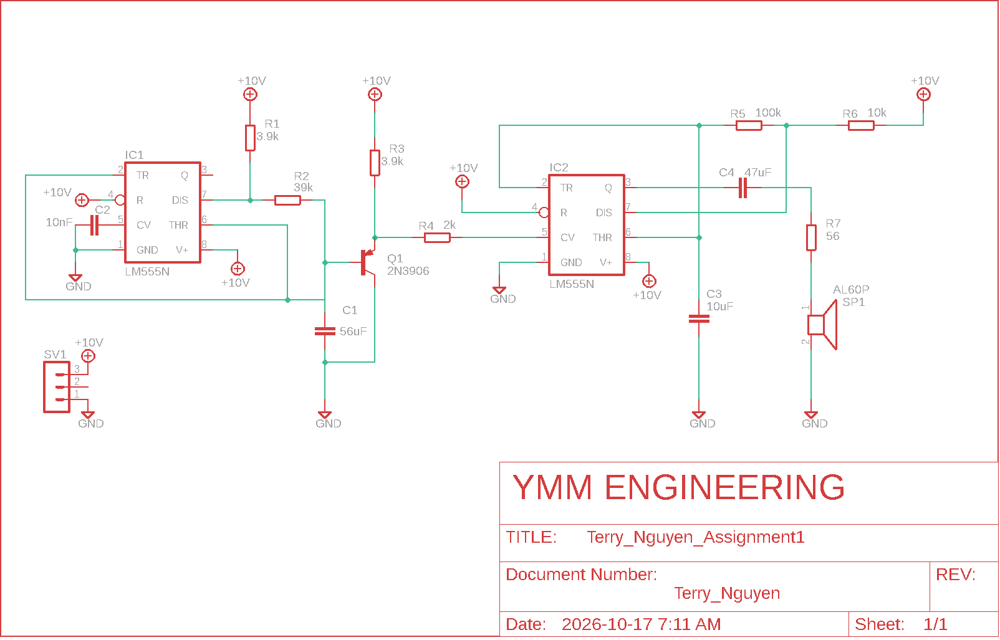

# Hardware & Electronics Labs

Circuit design, PCB layout, microcontroller and FPGA work from the Computer Engineering Technology program at Sheridan College (2023).

## PCB design: Autodesk EAGLE (`eagle-pcb/`)
| Project | What it is | Images |
|---|---|---|
| **Electronic siren** (Assignment 1) | Two LM555 timers: one slowly ramps the pitch of the other to drive a speaker | [schematic](eagle-pcb/Assignment1/electronic_siren_schematic.png) |
| **Midterm power board** | MC33269 voltage regulator board with DC barrel jack and filtering | [schematic](eagle-pcb/Midterm/midterm_schematic.png) · [board](eagle-pcb/Midterm/midterm_board.png) |
| **PIC programmer board** (Lab 1) | PIC16F84A circuit with programming header, crystal and 5 V regulator | [schematic](eagle-pcb/Lab1/lab1_schematic.png) · [board](eagle-pcb/Lab1/lab1_board.png) |
| **Low-pass & band-pass filters** (Lab 2) | Analog filter circuits and their layouts | [LPF](eagle-pcb/TN_project/low_pass_filter_schematic.png) · [BPF](eagle-pcb/TN_project/band_pass_filter_schematic.png) |
| **LED blinker** (Week 3) | Through-hole blinker circuit | [schematic](eagle-pcb/WEEK3/blinker_schematic.png) · [board](eagle-pcb/WEEK3/blinker_board.png) |

## FPGA: VHDL (`fpga-vhdl/`)
- **`lab9_pwm.vhd`**: PWM generator for a 50 MHz FPGA board. It outputs a 2 kHz signal, and a switch toggles the duty cycle between 70% and 10%.
- **`full_adder.vhd`, `full_adder2.vhd`**: an early draft of a 4-bit ripple-carry adder (work in progress, doesn't compile as-is)

## Digital logic simulation: NI Multisim (`multisim/`)
Lab 7 decoder circuits built from 74-series logic chips and simulated in Multisim 14.1. They open in desktop Multisim or the free browser version at [multisim.com](https://www.multisim.com).
- **`74138_3-to-8_decoder.ms14`**: a 74138 decoder that turns a 3-bit binary input into one of 8 active outputs
- **`7447_bcd-to-7-segment_decoder.ms14`**: a 7447 decoder that drives a 7-segment display to show digits 0–9

<!-- Add screenshots of both circuits here. -->

## Microcontrollers: PSoC 5LP (`psoc-5lp/`)
Labs on the Cypress/Infineon CY8CKIT-059 kit, built in PSoC Creator: LED blinking (Lab 3/4) and a character LCD display (Lab 5). Each folder holds the `main.c` firmware and the project/schematic files.

## Other
- `autocad/`: 2D drafting exercises and final exam drawing (`.dwg`, opens in [Autodesk Viewer](https://viewer.autodesk.com))
- `tinkercad/`: circuit simulations (Lab 3 and Lab 4 electric siren)

## Tools
Autodesk EAGLE · PSoC Creator 4.4 · Intel Quartus Prime · NI Multisim · AutoCAD · Tinkercad
